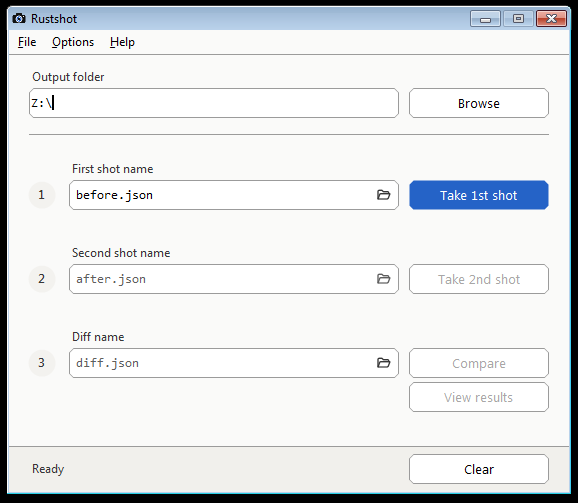
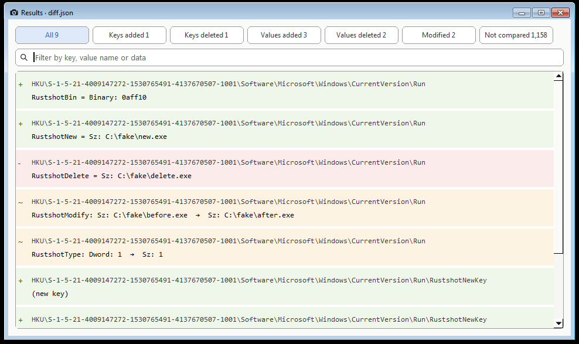
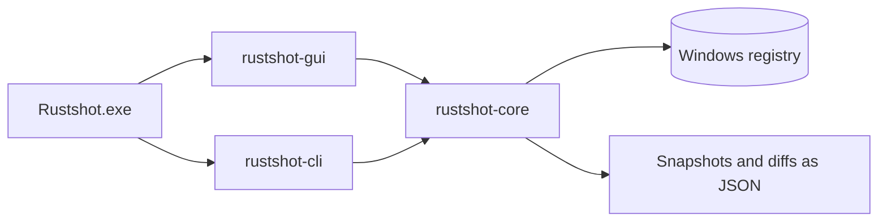

<p align="center">
  <picture>
    <source media="(prefers-color-scheme: dark)" srcset="docs/media/rustshot-dark.svg">
    
  </picture>
</p>

<h1 align="center">Rustshot</h1>

<p align="center">
  Registry snapshots and diffs for Windows malware analysis.
</p>

<br>

Rustshot takes a snapshot of the Windows registry before and after running a
sample, and compares both to show what changed: keys added and deleted, and
values added, deleted and modified.

It is a single static `.exe` with a graphical interface and a command line, and
it runs on Windows 7, 8, 10 and 11 without installing anything.

<br>

<p align="center">
  <picture>
    <source media="(prefers-color-scheme: dark)" srcset="docs/media/capture-window-dark.png">
    
  </picture>
</p>

<p align="center">
  <picture>
    <source media="(prefers-color-scheme: dark)" srcset="docs/media/results-window-dark.png">
    
  </picture>
</p>


## What Rustshot Solves

When a sample runs, it often leaves its traces in the registry: persistence in
`Run` keys, new services, disabled security settings or its own configuration.
Finding them by hand among hundreds of thousands of keys is slow and easy to
get wrong.

Rustshot does the comparison for you, in the spirit of Regshot:

1. Take a shot of the clean system.
2. Run the sample.
3. Take a second shot.
4. Compare them and review the changes.

Both shots and the diff are saved as JSON, so they can be kept as evidence,
opened again later or processed by other tools.


## Main Features

| Area | Capabilities |
| --- | --- |
| Capture | The whole registry (`HKLM` and `HKU`), with every value and its type |
| Comparison | Keys added and deleted, values added, deleted and modified |
| Reliability | Keys that cannot be read are recorded and left out of the diff, instead of showing up as false changes |
| Interface | GUI with live progress, filters, search and light or dark theme |
| Command line | `shot` and `diff` commands for scripts and remote sessions |
| Portability | One static `.exe` per architecture, from Windows 7 to 11 |


## Architecture Overview



The project is a Cargo workspace split into three crates:

- `crates/core/`: capture of the registry, comparison and JSON files.
- `crates/cli/`: command line arguments and commands.
- `crates/gui/`: windows, theme and background tasks.

The root crate builds `Rustshot.exe` and decides which interface to open.


## Quick Start

Download the `.exe` that matches your Windows from the releases page:

| File | Windows |
| --- | --- |
| `Rustshot.exe` | 64-bit Windows 7, 8, 10 and 11 |
| `Rustshot32.exe` | 32-bit Windows 7, 8, 10 and 11 |

Run it as administrator to read as much of the registry as possible.

**Graphical interface**

Open the `.exe` with a double click, then take the first shot, run the sample,
take the second shot and press **Compare**.

**Command line**

```powershell
.\Rustshot.exe shot -o before.json
```

```powershell
.\Rustshot.exe shot -o after.json
```

```powershell
.\Rustshot.exe diff before.json after.json -o diff.json
```


## Documentation

- [Getting Started](docs/getting-started/README.md)
- [Registry](docs/registry/README.md)
- [File Formats](docs/formats/README.md)
- [Architecture](docs/architecture/README.md)
- [Building](docs/building/README.md)
- [Troubleshooting](docs/troubleshooting/README.md)
- [Roadmap](docs/roadmap/README.md)


## License

Rustshot is licensed under the GNU Affero General Public License v3.0. See
[LICENSE](LICENSE).
