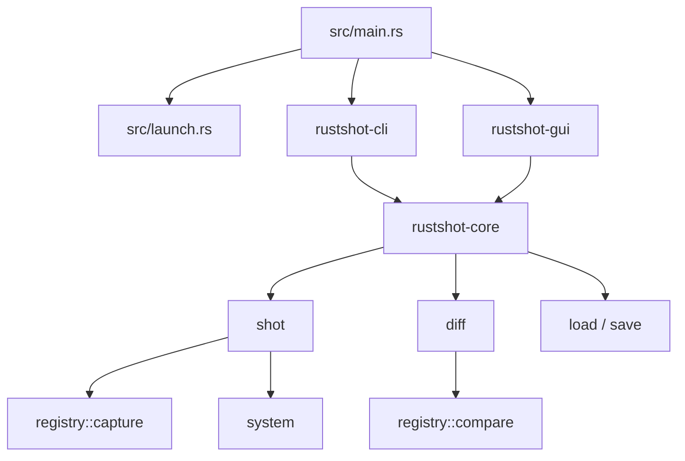
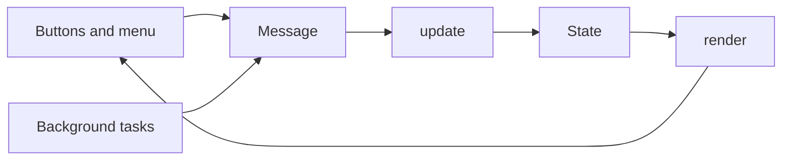

# Architecture

Rustshot is a Cargo workspace with three library crates and one binary. The
core crate does all the work on the registry. The command line and the
graphical interface are thin layers on top of it.


## System Overview



The boundary is simple:

- `rustshot-core` knows the registry and the JSON files, and nothing about
  windows or terminals.
- `rustshot-cli` and `rustshot-gui` know how to talk to the analyst, and call
  the core for everything else.
- The root crate only builds `Rustshot.exe` and chooses the interface.


## Workspace

```text
Rustshot/
    src/                Rustshot.exe: entry point
    build.rs            Icon and version details of the .exe
    crates/
        core/           rustshot-core
        cli/            rustshot-cli
        gui/            rustshot-gui
    docs/
```

The version, edition and license are set once, in `[workspace.package]` of the
root `Cargo.toml`, and shared by every crate.


## Entry Point

```text
src/
    main.rs
    launch.rs
```

`Rustshot.exe` is a console program, because it is also the command line. When
it is opened with a double click, Windows creates a console just for it.

`main.rs` opens the graphical interface when there are no arguments and only
Rustshot is attached to the console, which means it was opened with a double
click. In that case `launch.rs` closes the console first. In any other case,
the command line runs.


## Core

```text
crates/core/src/
    shot.rs             shot(): captures a snapshot
    diff.rs             diff(): compares two snapshots
    system.rs           Windows version and device details
    registry/
        capture.rs      Walk of the registry
        compare.rs      Comparison of keys and values
        progress.rs     Counts reported while capturing
    storage.rs          load() and save() of the JSON files
    error.rs            Errors of reading and writing files
    hex.rs              Bytes as hexadecimal text in the JSON
    types/              Snapshot, diff and registry value types
```

The public API is in `lib.rs`:

| Item | Purpose |
| --- | --- |
| `shot(report)` | Captures the system. `report` receives the progress |
| `diff(before, after)` | Compares two snapshots |
| `load(path)`, `save(value, path)` | Reads and writes snapshots and diffs |
| `Error` | Error of reading or writing a file |
| `Snapshot`, `SnapshotDiff`, … | The types saved in the JSON |

The core is organized by source. `shot.rs` and `diff.rs` gather the sources,
and each source has its own folder with its capture and its comparison. Today
the only source is the registry.


### Progress

`shot` receives a function and calls it as the capture goes, with the keys,
values and inaccessible keys found so far. The core does not know who listens:
the command line prints a line, and the graphical interface sends a message to
its window.


## Command Line

```text
crates/cli/src/
    arguments.rs        clap definition of the commands
    commands.rs         shot and diff commands
```

`run()` parses the arguments with clap and runs the requested command. All
messages go to stderr.


## Graphical Interface

```text
crates/gui/src/
    app/                Event loop, actions and background tasks
    types/              State and messages
    view/               Windows and widgets
    theme/              Colors, boxes, fonts and dark mode
    format.rs           Numbers and file names as text
```

The interface is built with FLTK and follows a message, state and render
pattern:



- Every button, menu item and background task sends a `Message`.
- `update` changes the `State` and starts tasks when needed.
- The capture window is drawn again from the `State` after every message.

The widgets keep no state of their own, except the text typed by the analyst.
The results window keeps its filter and its rows, because nothing else depends
on them.


### Background Tasks

Capturing, comparing and opening files run in background threads, so the
window keeps responding. Each task sends a message when it finishes, with its
result or its error.

A panic inside a task is turned into an error, so the window never stays busy
forever.

While a shot is taken, another thread sends a `Tick` every second to keep the
time up to date, because saving the file reports nothing.


### Theme

Each color is a slot of the FLTK color map. Changing the theme fills the slots
with the light or the dark values and draws the windows again, so it changes
at once without restarting.

On Windows 10 and 11, the title bar is asked to be dark too, through
`DwmSetWindowAttribute`.


## Adding a Source

A new source, such as the file system, would follow the shape of the registry:

1. Add its folder under `crates/core/src/`, with `capture.rs` and `compare.rs`.
2. Add its data to `SnapshotData` and its changes to `DiffChanges`.
3. Call its capture from `shot.rs` and its comparison from `diff.rs`.
4. Show its changes in the interfaces.

The registry code does not need to change.
