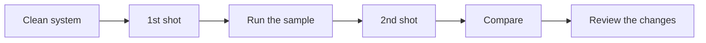

# Getting Started

This section explains how to choose the right binary and how to run a
complete analysis with the graphical interface or the command line.

## Workflow

Every analysis follows the same steps, whatever the interface:

Take the first shot on a clean system, ideally right after restoring the
virtual machine to a snapshot. Take the second shot once the sample has run
for as long as you need.

## Choosing a Binary

| File | Build target | Windows |
| --- | --- | --- |
| `Rustshot.exe` | `x86_64-win7-windows-gnu` | 64-bit Windows 7, 8, 10 and 11 |
| `Rustshot32.exe` | `i686-win7-windows-gnu` | 32-bit Windows 7, 8, 10 and 11 |

Both binaries read the 64-bit view of the registry, so both capture it whole on
any Windows. On 64-bit Windows, use `Rustshot.exe`: it has no memory limit for
large registries.

Rustshot needs no installation. Copy the `.exe` into the virtual machine and
run it from there.

## Permissions

Run Rustshot as administrator. Without administrator rights, many keys under
`HKLM` cannot be opened and are recorded as inaccessible.

Some keys, such as `HKLM\SAM\SAM` and `HKLM\SECURITY`, can only be read by the
`SYSTEM` account. They are inaccessible even for administrators, and that is
expected. See [Registry](../registry/README.md) for how they are handled.

## How Rustshot Starts

`Rustshot.exe` is both the graphical interface and the command line:

| How it is opened | What starts |
| --- | --- |
| Double click, without arguments | Graphical interface |
| From a terminal, with arguments | Command line |
| From a terminal, without arguments | Command line help |

## Documents

- [Graphical interface](gui.md)
- [Command line](cli.md)
