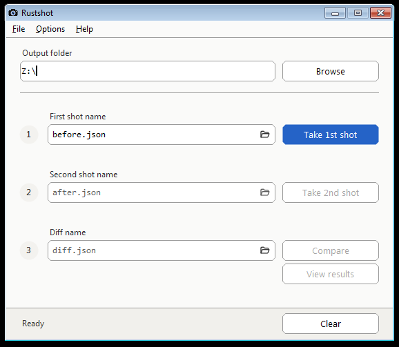
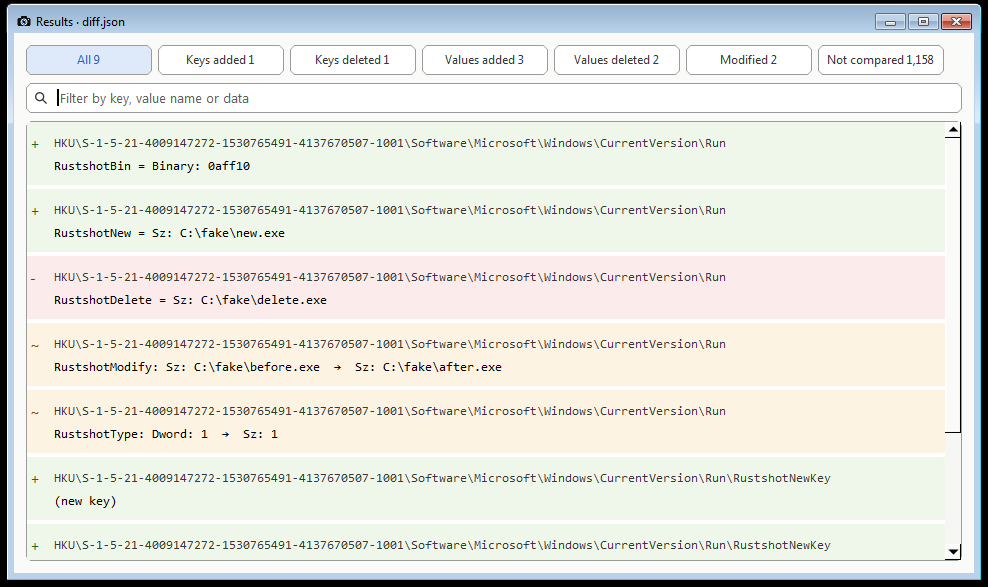

# Graphical Interface

The graphical interface has two windows: the capture window, where the shots
are taken, and the results window, where the changes are reviewed.


## Capture Window

The capture window guides the three steps of an analysis from top to bottom.

<p align="center">
  <picture>
    <source media="(prefers-color-scheme: dark)" srcset="../media/capture-window-dark.png">
    
  </picture>
</p>

| Part | Purpose |
| --- | --- |
| Output folder | Folder where the shots and the diff are saved |
| Step 1 | Name of the first shot and **Take 1st shot** |
| Step 2 | Name of the second shot and **Take 2nd shot** |
| Step 3 | Name of the diff, **Compare** and **View results** |
| Footer | Status of the last action and **Clear** |

The output folder starts as the folder Rustshot was opened from. The default
names are `before.json`, `after.json` and `diff.json`.

Each step is enabled once the previous one is done. Retaking the first shot
discards the second shot and the diff, because they no longer match.


### Progress

While a shot is taken, the line below its field shows how it goes:

```text
123,000 keys, 456,789 values, 14 inaccessible · 12 s
```

When it finishes, the line shows the final count and the footer shows the file
that was saved.


### Opening Existing Files

The folder button inside each field opens a file saved before, instead of
taking the shot or running the comparison again. This is useful to compare
shots taken on another day, or to review an old diff.

The same actions are in the **File** menu:

| Menu | Action |
| --- | --- |
| File → Open shot → First… | Opens a snapshot as the first shot |
| File → Open shot → Second… | Opens a snapshot as the second shot |
| File → Open diff… | Opens a diff and shows its results |
| File → Exit | Closes Rustshot |


## Results Window

The results window lists every change of the diff, sorted by key path.

<p align="center">
  <picture>
    <source media="(prefers-color-scheme: dark)" srcset="../media/results-window-dark.png">
    
  </picture>
</p>

Each change is a block with a symbol, the key path and the value:

| Symbol | Color | Meaning |
| --- | --- | --- |
| `+` | Green | Key or value added |
| `-` | Red | Key or value deleted |
| `~` | Amber | Value modified, shown as `before → after` |
| `?` | Grey | Key not compared |
| `!` | Amber | Key not compared that became unreadable in the 2nd shot |

The last one is worth a look: a key that could be read before the sample ran
and not after may have been locked by it.


### Filters and Search

The buttons at the top filter the list and show how many changes of each kind
there are:

- All
- Keys added
- Keys deleted
- Values added
- Values deleted
- Modified
- Not compared

**All** shows every change, but not the keys that were not compared: they are
not changes, so they only appear with their own filter.

The search field filters by key path, value name or value data, and ignores
case.


## Theme

**Options → Theme** chooses the colors of both windows:

| Option | Colors |
| --- | --- |
| System | Follows the Windows setting, light on Windows 7 and 8 |
| Light | Always light |
| Dark | Always dark, title bar included on Windows 10 and 11 |

The theme changes at once, without restarting. It is not saved: Rustshot
writes nothing to the registry, so it never shows up in its own diffs.
