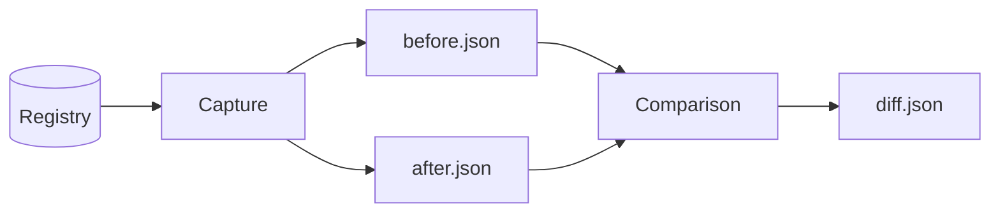

# Registry

Rustshot works on the Windows registry in two stages: the capture, which reads
it into a snapshot, and the comparison, which finds what changed between two
snapshots.



Both stages live in the core crate, under:

```text
crates/core/src/registry/
    capture.rs
    compare.rs
    progress.rs
```


## Documents

- [Capture](capture.md)
- [Comparison](comparison.md)


## Key Ideas

| Idea | Why it matters |
| --- | --- |
| The whole registry is captured | Nothing is missed because of a filter |
| The 64-bit view is read | The 32-bit binary sees the same as the 64-bit one |
| Unreadable keys are recorded | The snapshot says what it could not see |
| Unreadable keys are not compared | They never show up as false additions or deletions |
